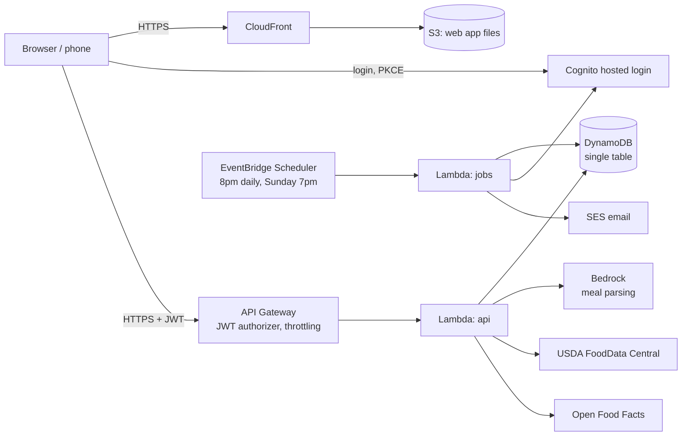

# Plate: a serverless protein, sleep, and training tracker

**Live app:** https://d88lgmeztl9fe.cloudfront.net
A phone-friendly web app I use daily to hit my protein goal, get 8 hours of
sleep, and see how sleep affects my training. Built entirely on AWS
serverless services, defined in Terraform, and costing about $0–3 per month.

## Features

- **Today view** showing protein left to eat (the number I check most), plus calories, sleep, and training volume.
- **Describe a meal in plain English** ("3 eggs and a protein shake"). Amazon Bedrock estimates the foods and portions, the USDA database supplies the nutrition values, and I confirm before saving.
- **Food search** against USDA FoodData Central, and **barcode scanning** of packaged foods through Open Food Facts.
- **Training log** (sets × reps × weight) and **sleep log**.
- **Trends**: averages, goal streaks, and training volume after full vs. short nights of sleep.
- **Evening email** if I'm behind on protein or haven't logged sleep, and a **weekly summary** every Sunday.
- **Invite-only login** with Amazon Cognito.

## Architecture



## Project structure

```
backend/src/handler.py    API Lambda: routing, request parsing, responses
backend/src/logic.py      Validation, daily math, insights, email text (no AWS: fully unit tested)
backend/src/db.py         All DynamoDB access, including the cache
backend/src/nutrition.py  USDA and Open Food Facts lookups
backend/src/ai.py         Bedrock meal parsing and output validation
backend/src/jobs.py       Scheduled emails
backend/tests/            Unit tests (pytest)
frontend/                 Plain HTML/CSS/JS app, no build step
infra/                    Terraform, one file per area (api.tf, auth.tf, ...)
scripts/deploy.sh         Test + deploy in one command
.github/workflows/ci.yml  Tests and Terraform checks on every push
```

## Setup

You need the AWS CLI, Terraform 1.5+, and Python 3.9+.

```bash
# 1. Log in to AWS (this project's account uses `aws login`)
aws configure set region us-east-2 --profile fitness
aws login --profile fitness

# 2. Python environment for tests
cd backend
python3 -m venv .venv
source .venv/bin/activate
pip install -r requirements-dev.txt
pytest
cd ..

# 3. Settings
cp infra/terraform.tfvars.example infra/terraform.tfvars   # then edit it

# 4. Deploy (runs the tests, then terraform apply)
cd infra && terraform init && cd ..
./scripts/deploy.sh
```

After the first deploy:

1. **Click the AWS verification email** (from SES) so the app can send you reminders.
2. **Check for the Cognito email** with your temporary password.
3. Open the `app_url` from the deploy output, sign in, and choose a new password.
4. Set your goals on the Goals tab.

To remove everything: `cd infra && terraform destroy`.

## Design decisions

**Single-table DynamoDB design.** Items are keyed `PK = USER#<id>` with sort keys like
`DAY#2026-10-11#MEAL#<id>`, `DAY#2026-10-11#SLEEP`, and `GOALS`. One `begins_with` query
fetches a whole day, and one `between` query fetches a date range for trends.

**The AI estimates portions, not nutrition.** Bedrock turns "3 eggs" into
`{"food": "egg, whole, cooked", "grams": 150}`, and the calories and protein come from
USDA data. That keeps the numbers grounded in a real database. The model's output is
treated as untrusted: it's parsed defensively, every field is validated, and the user
confirms the estimate before anything is saved.

**Caching outside APIs.** USDA and barcode lookups are cached in DynamoDB for 30 days
with a TTL attribute, so repeated foods don't hit rate-limited APIs, and DynamoDB deletes
expired entries for free.

**Authentication at the edge.** API Gateway validates the Cognito JWT before Lambda runs,
so unauthenticated requests cost nothing. The user ID comes from the token's `sub` claim,
never from the request body, so one user can't read another's data.

**PKCE login without a client secret.** A browser can't keep a secret, so the app uses the
OAuth authorization code flow with PKCE, written by hand in `frontend/auth.js` (about 100
lines, no SDK).

**Invite-only, with cost guardrails.** Cognito self-sign-up is disabled, the API is
throttled (with a much lower limit on the paid AI route), logs expire after 14 days, and a
budget alert counts usage before credits are applied.

**Time zones.** The browser always sends its own local date, so "today" matches the user's
day. For scheduled emails, EventBridge Scheduler runs in the user's IANA time zone, and the
server works out the local date from a UTC offset the browser saved with the goals. That
offset can be an hour stale after a daylight-saving change, which never changes the date at
8pm.

**Sleep belongs to the day you wake up.** That's what makes "did I train harder after
sleeping 8 hours?" a simple same-day comparison.

**No frontend framework.** The app is a few hundred lines of plain JavaScript with no build
step, served from S3 through CloudFront. Caching is disabled, so deploys show up instantly;
at this traffic level that costs nothing.

**CI without cloud credentials.** GitHub Actions runs the unit tests, `terraform fmt`, and
`terraform validate` on every push. Deploys stay manual: this AWS account type blocks the
OpenID Connect provider GitHub would need, and I chose not to store long-lived AWS keys in
GitHub.

## Testing

```bash
cd backend && pytest -v
```

Business logic, AI output validation, and nutrition parsing are pure functions tested
without AWS or network access. `api.http` has ready-made requests for VS Code's
REST Client extension.

## Known limitations and next steps

- Terraform state is stored locally; moving it to S3 would allow deploying from CI.
- SES is in sandbox mode, so emails only go to verified addresses (fine for invite-only use).
- Workout weight has no unit; one unit should be used consistently.
- Possible next steps: a data export, editing entries in place, and a dashboard for weekly protein vs. training volume.
